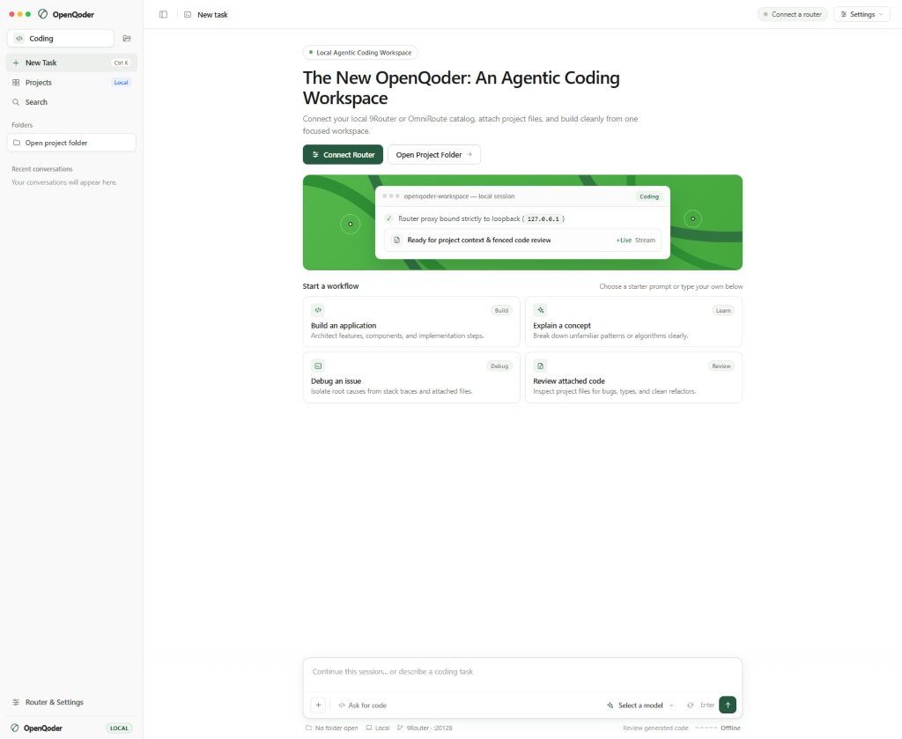
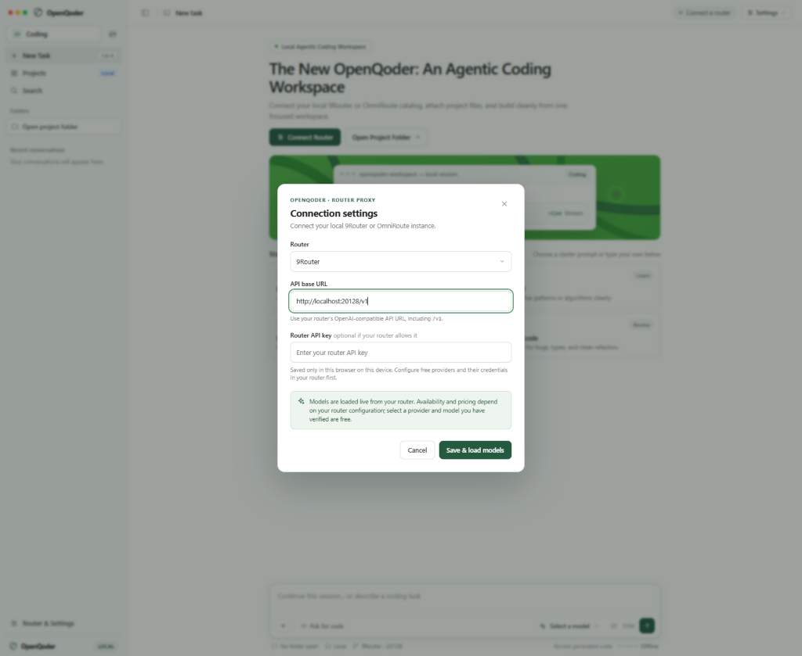
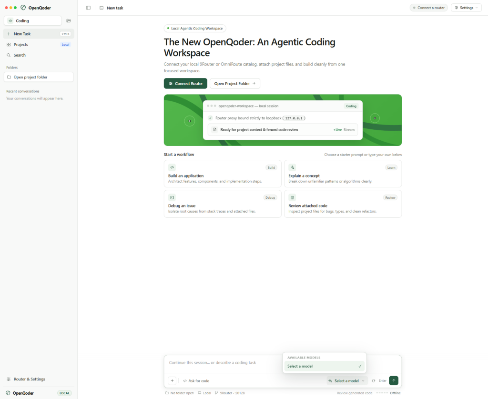

# OpenQoder

A lightweight local autonomous coding agent and multimodal workspace for an existing 9Router or OmniRoute installation. It discovers models from the router's live OpenAI-compatible catalog, inspects code and images, edits files with diff review and undo, and executes workspace commands through the selected router. OpenQoder is an independent project, not an official Qoder product.

## Screenshots

### Connection Settings, Model Selector & Sidebar Search

| Connection settings | Model selector | Sidebar search |
| --- | --- | --- |
|  |  |  |

## Start

1. Install Python 3.9 or newer. No Python packages are required.
2. Start and configure [9Router](https://github.com/decolua/9router) or [OmniRoute](https://github.com/diegosouzapw/OmniRoute). Connect the providers you want to use in that router's dashboard. Both commonly expose `http://localhost:20128/v1`; use a different port if that is how your instance is configured.
3. Double-click **Start OpenQoder.cmd**, or run `python server.py --open` from this folder. Keep the terminal window open. The app opens at `http://127.0.0.1:8765`, or the next available port through 8795. The terminal shows the actual address. Close the terminal or press Ctrl+C to stop it.
4. In the app, enter your router's local base URL and its endpoint API key, connect, and select a model from the live list. Refresh the list after changing providers or models in your router.

To use another app port, run `python server.py --port 8766 --open`.

## Model availability and costs

The live catalog comes from your router and may include paid as well as free models. A catalog entry does not guarantee that a model is free, currently available, configured, or suitable for chat. Check the provider's terms, account, and quotas in your router before use. Specific model names, including DeepSeek, GLM, ERNIE, and Qwen variants, only appear if your installed router exposes them; OpenQoder does not manufacture model access or silently substitute models.

## Autonomous Agent & Vision Capabilities

OpenQoder operates as a local autonomous coding agent when a workspace folder is opened:

- **Workspace Tools**: Lists files, searches text/regex across the project, reads text files with line numbers, performs targeted `edit_file` patches or `write_file` / `delete_file` operations, and runs shell commands inside the workspace root with timeout capture.
- **Image Reading (Vision)**: Attach images via the composer button, paste screenshots (`Ctrl+V`), drag-and-drop image files, or click image assets in the workspace sidebar. The autonomous agent's `read_file` tool can also read `.png`, `.jpg`, `.jpeg`, `.webp`, `.gif`, and `.bmp` files directly from the workspace and pass them visually to vision-capable models.
- **Approval Modes, Diff Review & Undo**: Choose between **Ask for approval** (auto-runs read/search tools while prompting before file writes or shell commands), **Auto-run**, or **Read-only**. Every turn that modifies files displays an `Edited N files` summary with `+added -removed` stats, expandable unified diffs (`Review`), and one-click `Undo`.

## Scope and privacy

The server binds strictly to loopback (`127.0.0.1`), scopes file operations to your selected workspace folder, and proxies model requests only to local HTTP router addresses. The browser stores connection settings (including the router key), workspace path, and chat history locally. File contents, attached images, and conversation content pass to your selected router and onward to its configured provider. Review the router and provider privacy policies for their handling of your data.

If the catalog does not load, check that the router is running, that its API key and port are correct, and that at least one provider is connected. The two routers use the same default port, so run them on different ports if using both at once.

## License

OpenQoder is released under the [Unlicense](LICENSE).
